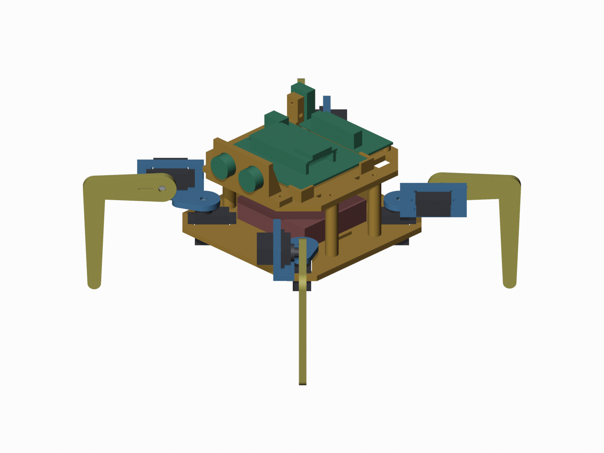
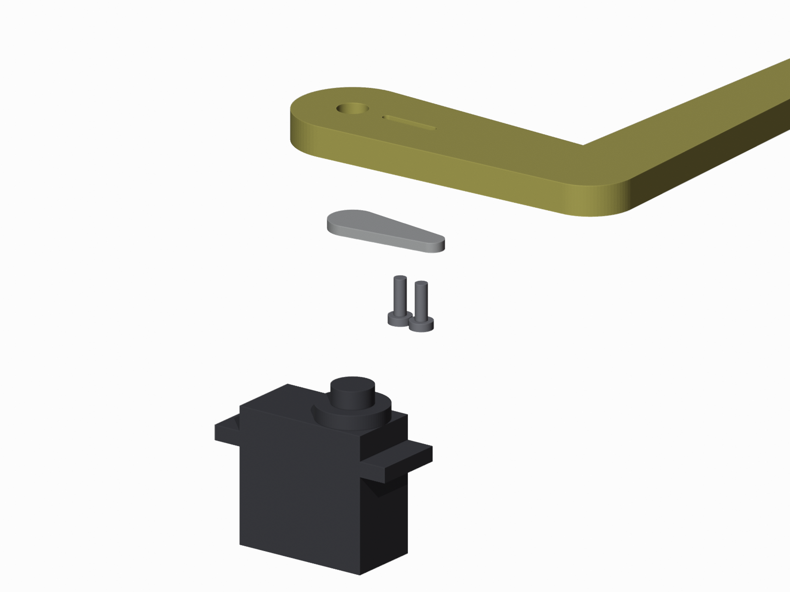

# spider-bot-8

**An open-source, 3D-printed, 8-servo spider robot you can build and program yourself.**
ESP32 + PCA9685 servo module · 8 × MG90S servos · 4 × AA batteries · no supports needed to print.

The robot stands up, sits down, and walks forward and backward with a stable **crawl gait**: only one leg is in the air at a time. The project comes with a step-by-step student manual, starting from how a servo motor works. It was made for students aged about 13–16, but anyone can build it.

## What's in this project

| Folder | What's inside |
| --- | --- |
| [`docs/manual.html`](docs/manual.html) | **Start here.** The full build and code manual. Download it and open it in any browser: it works offline |
| [`hardware/`](hardware/) | 3D-print files (STL), editable CAD files (STEP) and the parametric FreeCAD script that makes them |
| [`firmware/`](firmware/) | Arduino sketches P1–P9, from "find the servo module" to "walk forward and backward" |
| [`docs/manual_source/`](docs/manual_source/) | The manual's source text and the script that builds it |

## The manual, chapter by chapter

1. How servo motors work: pulses, angles and an interactive pulse simulator
2. The servo module (PCA9685): I2C, wiring, power
3. Controlling servo motors with code: one servo, a servo tester, one leg taking a step
4. Assembly and calibration: trims and directions for all 8 servos
5. Stand up and sit down
6. Walk forward: centre of mass, support triangle and the crawl gait (with a step-by-step diagram)
7. Walk backward

## Parts (about AU$60–80)

| Part | Qty |
| --- | --- |
| ESP32 38-pin DevKit on an expansion board | 1 |
| PCA9685 16-channel servo module | 1 |
| MG90S metal-gear micro servo | 8 |
| 4 × AA battery holder with switch, plus batteries | 1 |
| M2 × 5–6 mm self-tapping screws (servo horns) | 16 |
| M3 and M2.5 screws, zip ties, Velcro strap | a few |
| PLA filament | about 200 g |

## Quick start

1. **Print:** start with [`hardware/print_one_leg/one_leg_set.stl`](hardware/print_one_leg/) and test one leg. Then print the rest (see [`hardware/README.md`](hardware/README.md)).
2. **Software:**
   - Install Arduino IDE 2.
   - Add **esp32 by Espressif Systems** in the Boards Manager.
   - Add the **Adafruit PWM Servo Driver** library.
3. **Follow the manual,** running the sketches in [`firmware/`](firmware/) in order, P1 to P9.

## How it walks

The legs step in the order rear-left → front-left → rear-right → front-right. Before each leg lifts, the other three are spread so that the robot's centre of mass stays inside the triangle they make on the floor. After each step, all four feet push back together and the body slides forward. Walking backward is the same sequence played in reverse. Chapter 6 of the manual explains it with an interactive diagram.

## Made something with it?

Students and makers are welcome to build, remix and improve this robot. If you use it in a project, report or portfolio, please credit it like this:

> Based on **spider-bot-8** by DRODI, an open-source 8-servo spider robot (MIT / CC BY-SA 4.0).

There is also a [`CITATION.cff`](CITATION.cff) file. GitHub's **"Cite this repository"** button uses it to make a citation for you.

Found a bug or made it better? Open an issue or a pull request.

## Licence

- **Code** (`firmware/`, the `.py` scripts): [MIT](LICENSE)
- **3D designs and the manual** (`hardware/` STL/STEP files, `docs/`): [CC BY-SA 4.0](LICENSE-CC-BY-SA.md). You may share and remix them, as long as you credit **DRODI** and share your version under the same licence.

© 2026 DRODI
