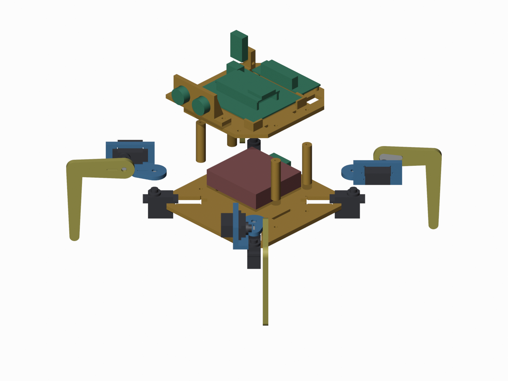

# Hardware



## Print list
**Settings:** PLA, 0.2 mm layers, 3 walls, 25% infill, **no supports**. The STL files are already oriented for printing.

| # | File (`stl/`) | Qty | Notes |
|---|---|---|---|
| 1 | `fit_test.stl` | 1 | **Print first.** Check that an MG90S drops into the slot and a horn fits the pocket |
| 2 | `screw_test.stl` | 1 | One hole per screw size, to check your printer's hole sizes |
| 3 | `../print_one_leg/one_leg_set.stl` | 1 | One shoulder + one leg on one plate. Build and test one leg first |
| 4 | `coxa.stl` (shoulder) | 4 total | Flat plate on the hip horn plus one wall that holds the lift servo |
| 5 | `leg.stl` | 4 total | L-shaped leg, 45 mm out and 75 mm down |
| 6 | `body_bottom.stl` | 1 | Flat 4 mm plate: hip servo slots, battery strap slots |
| 7 | `spacer.stl` | 4 | Lid pillars, 40 mm. Print them standing up |
| 8 | `body_top.stl` | 1 | Lid: corner holders for the ESP32 expansion board, posts for the PCA9685, DHT22 post, cable slot |
| 9 | `sensor_head.stl` | 1 | HC-SR04 ultrasonic sensor holder, front edge of the lid |
| – | `leg_test_stand.stl` | optional | Clamps one hip servo to a table edge for testing a leg |

## Hardware
- 8 × MG90S servos, with their single-arm horns and screws
- 16 × M2 × 5–6 mm self-tapping screws: 2 per horn, through the horn's holes into the slot under the horn pocket
- M3 screws:
  - 8 for the spacers
  - 2 for the sensor head
- 4 × M2.5 screws for the PCA9685
- 2 zip ties for the ESP32 board
- 1 Velcro strap for the battery holder

## Layout
- **Inside, on the bottom plate:** the 4 × AA holder, plus an optional buck-boost 5 V module that powers the ESP32 from the batteries.
- **On the lid**, front to back:
  - sensor head
  - ESP32 expansion board (78 × 63 mm)
  - PCA9685 (at the back)
  - DHT22 post (back-left corner)
  - cable slot (back-right corner)

If your ESP32 expansion board isn't 78 × 63 mm, change `ESP_BOARD` in `build_robot.py` and rebuild.

## Editing the design
- **`step/`:** open these in Fusion 360, Onshape or FreeCAD. `assembly.step` is the whole robot.
- **`build_robot.py`:** a parametric FreeCAD script that generates every STL and STEP file. Change a number at the top (servo clearance, leg length, board size ...) and run:
  ```
  freecadcmd build_robot.py
  ```
  It also checks every part for collisions through the full range of every joint.
- **`render_blender.py`:** makes the preview pictures, using Blender:
  ```
  blender --background --python render_blender.py
  ```

## Wiring
| ESP32 | PCA9685 |
|---|---|
| 3V3 | VCC |
| GND | GND |
| GPIO 21 | SDA |
| GPIO 22 | SCL |

- **Batteries:** 4 × AA into the green terminal only. Red goes to V+, black to GND.
- **Servo channels:** each leg uses a hip channel and a lift channel.

| Leg | Hip channel | Lift channel |
|---|---|---|
| rear-left | 0 | 1 |
| rear-right | 4 | 5 |
| front-right | 8 | 9 |
| front-left | 12 | 13 |
